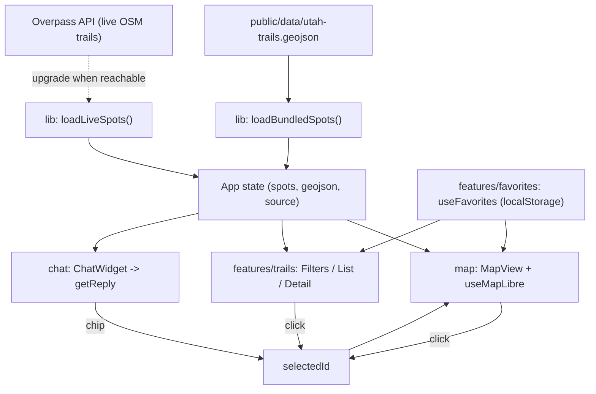

# Architecture Overview

This document gives the high-level picture of Trailhead and ties together the
individual decisions. The *why* behind each decision now lives as an
Architecture Decision Record (ADR) in [`docs/adr/`](./docs/adr/) - see the
[decision index](#decision-records) below.

> This file is meant to be edited by both of us. Keep it as the map of the
> system; record new decisions as ADRs rather than expanding this file.

## Goals

- A single app that works well on **desktop and phones/tablets**.
- **Map-first** experience built on **MapLibre**.
- A **"lite" AI chatbot** that needs **no API keys** and no external AI service.
- Start small: a **Utah-only** seed dataset, just enough to prove the idea.
- Decisions tracked as ADRs; tasks tracked in [`TODO.md`](./TODO.md).

## Modules

The app is organized into modules, each exposing a small public interface via an
`index.ts` barrel (see [ADR-0008](./docs/adr/0008-module-public-interfaces.md)).
Cross-module code imports only from these barrels; deep paths are reserved for a
module's own internals.

| Module | Public interface | Responsibility |
| --- | --- | --- |
| `lib` | `src/lib/index.ts` | Shared types, storage, data loader, design tokens (`COLORS`) |
| `map` | `src/map/index.ts` | MapLibre map (`MapView`, `MapViewHandle`) |
| `features/trails` | `src/features/trails/index.ts` | List, filters, detail, filter logic |
| `features/favorites` | `src/features/favorites/index.ts` | Local favorites hook |
| `features/theme` | `src/features/theme/index.ts` | Light/dark theme hook (system default, persisted) |
| `chat` | `src/chat/index.ts` | Offline rule-based chatbot widget |

## Data flow

## Notable implementation choices

- **Feature-state for favorites:** the map source uses `promoteId: "id"` and a
  golden "favorite ring" layer is driven via `setFeatureState`, avoiding
  per-change source reloads. See `src/map/layers.ts` and `src/map/useMapLibre.ts`.
- **Single source of truth for filters:** `src/features/trails/filters.ts` holds
  the `Filters` type and `applyFilters` used by the list, while the map receives
  just `type`/`difficulty` for its native layer filters.
- **Imperative map handle:** `MapView` exposes `flyToSpot` via
  `useImperativeHandle` so selecting from the list/chat recenters the map without
  prop-drilling the map instance.
- **Shared design tokens:** `COLORS` lives in `lib` so both the map layers and the
  list legend use the same palette without crossing module internals.
- **Progressive data load:** `App` renders the bundled seed immediately, then
  calls `loadLiveSpots()` (Overpass) and swaps in live OSM trails if reachable,
  falling back to the seed otherwise. A sidebar badge shows the active source.
- **Selected pin + highlight:** selecting a spot sets a `selected` feature-state
  (driving a blue highlight ring layer) and drops a MapLibre `Marker` at the
  spot. See `applySelected` in `src/map/useMapLibre.ts`.

## Decision records

The full rationale for each decision is in [`docs/adr/`](./docs/adr/):

| ADR | Title |
| --- | --- |
| [0001](./docs/adr/0001-record-architecture-decisions.md) | Record architecture decisions using MADR |
| [0002](./docs/adr/0002-use-react-vite-typescript.md) | Use React + Vite + TypeScript |
| [0003](./docs/adr/0003-deliver-as-installable-pwa.md) | Deliver the app as an installable PWA |
| [0004](./docs/adr/0004-maptiler-basemap-with-openfreemap-fallback.md) | MapTiler basemap with a keyless OpenFreeMap fallback |
| [0005](./docs/adr/0005-bundle-utah-geojson-seed-data.md) | Bundle a small Utah GeoJSON seed dataset |
| [0006](./docs/adr/0006-device-local-persistence.md) | Store user data device-locally only |
| [0007](./docs/adr/0007-rule-based-offline-chatbot.md) | Use a rule-based offline chatbot (no API keys) |
| [0008](./docs/adr/0008-module-public-interfaces.md) | Expose module public interfaces via barrel files |
| [0009](./docs/adr/0009-dark-mode-and-visual-theming.md) | Dark mode and AllTrails-inspired visual theming |
| [0010](./docs/adr/0010-live-osm-overpass-data.md) | Upgrade to live OpenStreetMap trail data via Overpass |

## Known limitations (by design, for now)

- Seed data is small and approximate (demo quality, Utah only).
- Trails are rendered as points, not full route lines.
- No user accounts or cross-device sync.
- Offline map coverage is limited to tiles the user has already viewed.
