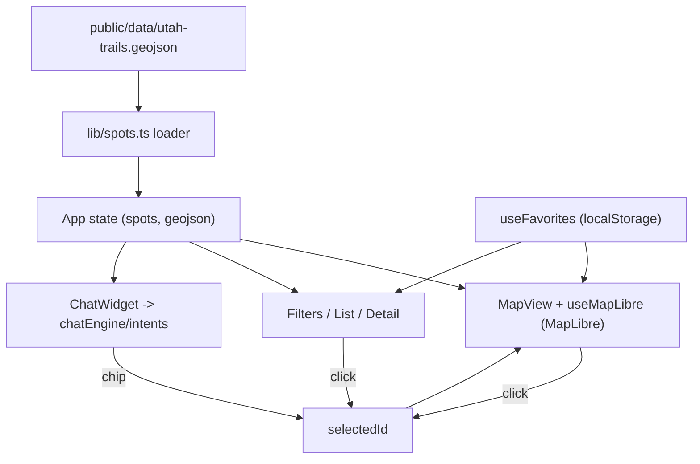

# Architecture & Decisions

This document records the key decisions behind Trailhead and *why* we made them,
so future changes are made with context. It's a living document - edit it as the
app evolves (add a dated note when a decision changes).

## Goals

- A single app that works well on **desktop and phones/tablets**.
- **Map-first** experience built on **MapLibre**.
- A **"lite" AI chatbot** that needs **no API keys** and no external AI service.
- Start small: a **Utah-only** seed dataset, just enough to prove the idea.
- Trackable progress via [`TODO.md`](./TODO.md) and shared docs.

## Decision log

### 1. Stack: React + Vite + TypeScript
- **Why:** Fast dev server and build (Vite), strong typing (TypeScript), and a
  huge ecosystem for maps and UI (React). Good fit for a component-driven,
  map-centric UI.
- **Alternatives considered:** Vue, Svelte, vanilla JS, Next.js. We don't need
  SSR or a backend yet, so Next.js was overkill; vanilla would slow feature work.

### 2. Delivery: Installable PWA
- **Why:** One responsive web app installs to desktop and mobile home screens,
  works offline, and avoids app-store friction. Matches "pull up on computers and
  phones/tablets."
- **How:** `vite-plugin-pwa` (Workbox) generates the manifest + service worker.
  We precache the app shell and seed data, and runtime-cache basemap tiles
  (`CacheFirst`) so a previously viewed area still renders offline.
- **Alternatives considered:** plain responsive site (no offline/install), or
  wrapping in Capacitor for native (deferred - can layer on later).

### 3. Map basemap: MapTiler key with keyless OpenFreeMap fallback
- **Why:** The user is fine with non-AI API keys, and MapTiler's "Outdoor" style
  looks great for this use case. But we never want a missing key to break the
  app, so when `VITE_MAPTILER_KEY` is absent we fall back to the keyless
  OpenFreeMap style. See `src/map/basemap.ts`.
- **Trade-off:** Two possible styles to reason about, but the app always runs.

### 4. Data: bundled Utah GeoJSON seed
- **Why:** The ask was "something that pulls only from the Utah area, nothing
  crazy big." A local `public/data/utah-trails.geojson` is fully offline,
  instant, and trivial to extend. No external data dependency to break.
- **Shape:** Point features with `id, name, type, difficulty, length_mi, region,
  description`. `type` is `park | trail`; parks have `null` difficulty/length.
- **Future:** Could add live OpenStreetMap/Overpass queries or official park
  APIs later without changing the UI, by swapping the loader in `src/lib/spots.ts`.

### 5. Persistence: device-local only
- **Why:** Discovery + favorites don't need accounts or a server. `localStorage`
  (wrapped in `src/lib/storage.ts`) keeps favorites on-device and fails safe if
  storage is unavailable.
- **Future:** If sync/accounts are ever needed, the favorites hook is the single
  integration point.

### 6. Chatbot: rule-based, fully offline
- **Why:** The explicit requirement was a "lite AI... not a big one, no API keys."
  A small intent-matching engine is instant, private, zero-cost, and works
  offline. See `src/chat/chatEngine.ts` and `src/chat/intents.ts`.
- **How it works:** Normalize the message, run ordered intent matchers (regex),
  first match wins; otherwise a friendly fallback. Several intents are
  data-driven (e.g. "easy trails", "what's in Zion?") and read from the same seed
  data the map uses, so answers stay in sync.
- **Future option:** If we ever want more natural replies, we could add a small
  in-browser model (e.g. WebLLM/transformers.js) behind the same `getReply`
  interface - still no server keys. Deliberately deferred to keep it lightweight.

## Data flow

## Notable implementation choices

- **Feature-state for favorites:** the map source uses `promoteId: "id"` and we
  drive a golden "favorite ring" layer via `setFeatureState`, avoiding per-change
  source reloads. See `src/map/layers.ts` and `src/map/useMapLibre.ts`.
- **Single source of truth for filters:** `src/features/trails/filters.ts` holds
  the `Filters` type and `applyFilters` used by the list, while the map receives
  just `type`/`difficulty` for its native layer filters.
- **Imperative map handle:** `MapView` exposes `flyToSpot` via `useImperativeHandle`
  so selecting from the list/chat recenters the map without prop-drilling the map
  instance.

## Known limitations (by design, for now)

- Seed data is small and approximate (demo quality, Utah only).
- Trails are rendered as points, not full route lines.
- No user accounts or cross-device sync.
- Offline map coverage is limited to tiles the user has already viewed.
